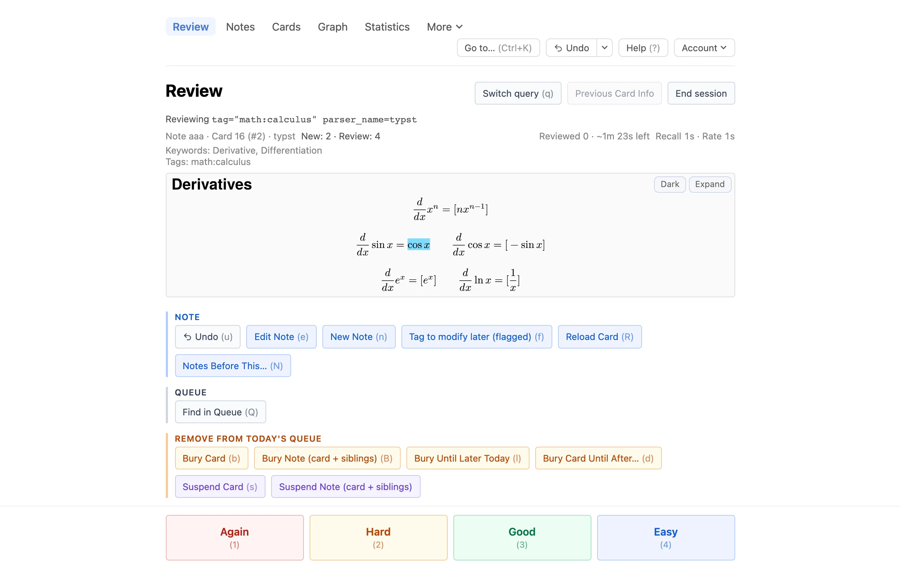
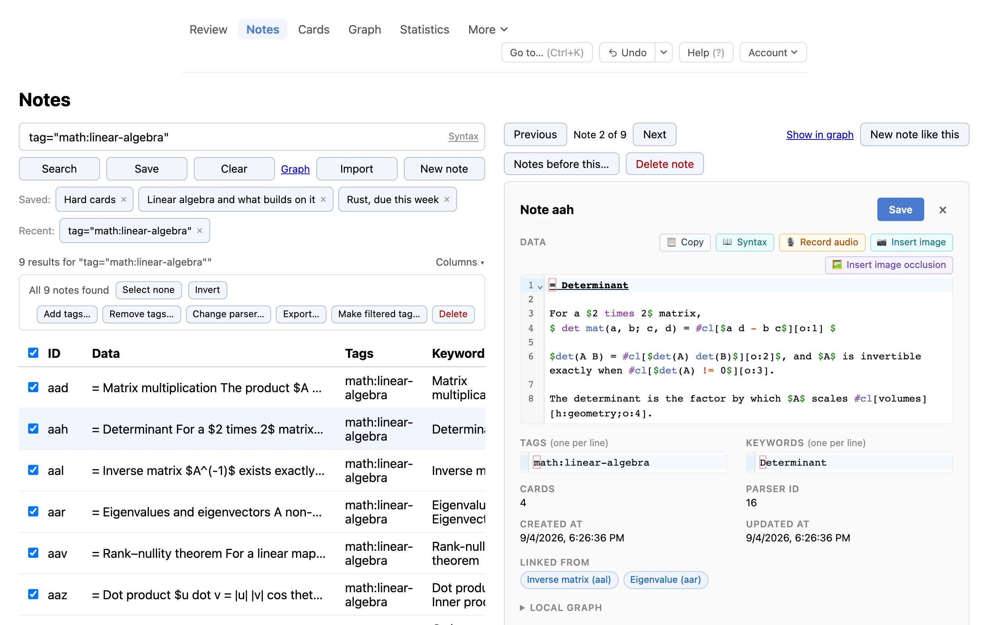
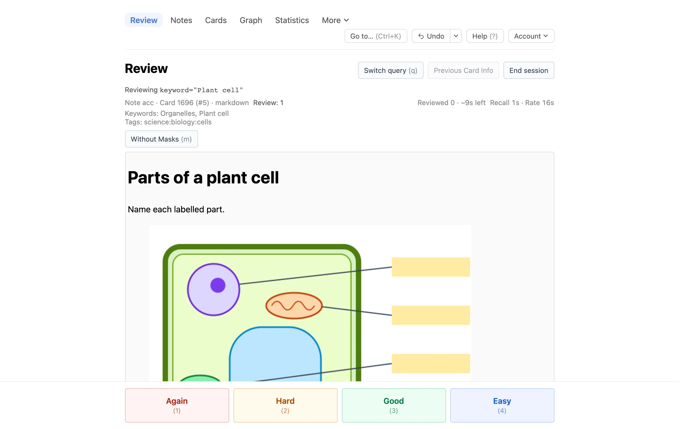
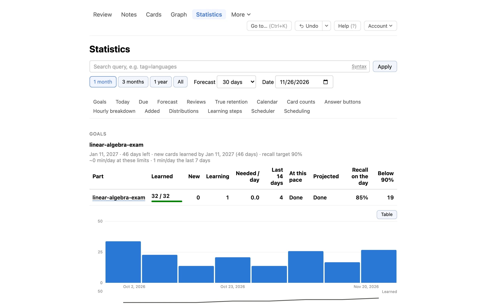
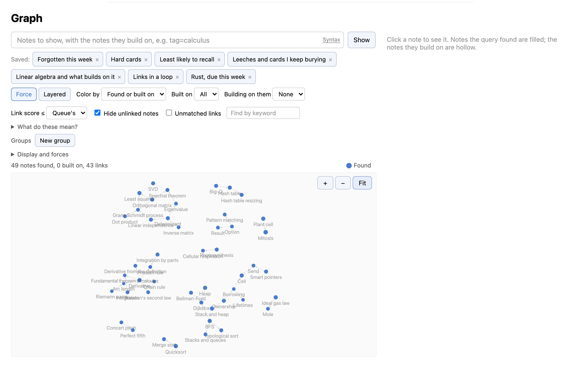

# Spares

**Spa**ced **Re**petition **S**ystem - A file-based note system built for programmers.

Spares was built to address the numerous drawbacks of Anki. See [this](spares_frontend/frontend/src/manual/comparison.md) for a more detailed comparison with Anki.

**[Try the demo](https://shivangp76.github.io/spares/)**: the web app with example notes and three months of made-up reviews, running entirely in your browser. Nothing to install, and nothing you do leaves your browser.

<picture>
  <source media="(prefers-color-scheme: dark)" srcset="docs/screenshots/review-dark.webp">
  
</picture>

> [!WARNING]
> Spares is in alpha: commands, settings and the web app may still change. Collections, note files and config files made since 2026-11-26 keep working across updates, which migrate them themselves.

## Features

### Core Features
- **File-based System**: All notes are stored as individual plain text files, enabling easy searching with standard tools like `ripgrep`
- **Multiple Markup Languages**: Support for Markdown, LaTeX, and Typst notes
- **Advanced Cloze System**:
  - Customizable cloze delimiters (not limited to double curly brackets)
  - Automatic cloze numbering
- **Flexible Architecture**:
  - All cards are fundamentally cloze-based
  - Decks implemented as tags
  - Pluggable scheduler (FSRS built in)

### Advanced Features
- **Image Occlusion**:
  - Integrated as a cloze type (not a separate note type)
  - Drawn in the web app's note editor
  - Support for interweaving image occlusion with text clozes
  - Hint display over image clozes
  - On a card's back, its images without masks (`m`), with their markup
- **Cross-note Referencing**:
  - Keyword-based linking system
  - Support for partial references
  - Multiple source citations
- **Tag Hierarchy**: Tree-like structure for organizing notes
- **Card Tags**: Tags on single cards, written on their clozes in note files (`tag:hard`), and a `buried` tag for the cards you keep burying instead of rating
- **LaTeX Integration**:
  - File-based templates that automatically update
  - Background parallel rendering

### Search and Scheduling
- **Search Queries**:
  - Query language with relative dates, review history fields and note links
  - Results ranked by relevance, with `--explain` to show how a query is read
  - Saved searches, synced across devices
- **FSRS Scheduling**:
  - Optimizer that fits FSRS's parameters to your review history (`spares card optimize`)
  - Load balancing of due dates across days
- **Review Queue**:
  - Daily limits, review order, presets by tag, sibling burying and leech handling, as in Anki
  - Cards held back until the notes they link to are learned

### Sync
- **Self-hosted Sync Server**: Two-way sync that merges notes changed on both sides, tagging conflicts with `sync-conflict`, between your machine, the server and phones that keep a copy
- **Deployment**: `spares deploy` sets up a VPS reached over Tailscale (see [Deploying a Sync Server](spares_frontend/frontend/src/manual/deploying.md))

### Interface and Tools
- **CLI**: Full-featured command-line interface, including reviewing
- **Web App**:
  - Installable on a phone, which can keep a copy of the collection and work offline
  - Note editor with Vim mode, image occlusion, image and audio uploads
  - Statistics graphs and a built-in manual
- **Neovim Plugin**: Tag and keyword completion (see [nvim](nvim/README.md))
- **Anki Migration**: Easy import from Anki decks
- **Customizable**: Create your own parsers and workflows

## Quick Start

See our [Getting Started Guide](spares_frontend/frontend/src/manual/getting_started.md).

## Screenshots

Taken from the [demo](https://shivangp76.github.io/spares/) (`cargo xtask screenshots` takes them again).

| | |
|---|---|
| <picture><source media="(prefers-color-scheme: dark)" srcset="docs/screenshots/notes-dark.webp"></picture> | <picture><source media="(prefers-color-scheme: dark)" srcset="docs/screenshots/image-occlusion-dark.webp"></picture> |
| Notes in Markdown, Typst or LaTeX, with clozes, links and keywords | Image occlusion, drawn in the note editor |
| <picture><source media="(prefers-color-scheme: dark)" srcset="docs/screenshots/statistics-dark.webp"></picture> | <picture><source media="(prefers-color-scheme: dark)" srcset="docs/screenshots/graph-dark.webp"></picture> |
| Statistics, FSRS's forecasts and goals | The graph of links between notes |

## Documentation

The manual is also in the web app, under Manual.

- [Getting Started](spares_frontend/frontend/src/manual/getting_started.md)
- [Deploying a Sync Server](spares_frontend/frontend/src/manual/deploying.md)
- [Concepts](spares_frontend/frontend/src/manual/concepts.md)
- [Workflows](spares_frontend/frontend/src/manual/workflows.md)
- [Language Tools](spares_frontend/frontend/src/manual/language-tools.md)
- [Comparison with Anki](spares_frontend/frontend/src/manual/comparison.md)
- API docs, with every setting and how each part works: `cargo doc --workspace --no-deps --document-private-items --open`

## Contributing

We welcome contributions! Please see our [Contributing Guide](CONTRIBUTING.md) for details.

## License

This project is licensed under either of:
- Apache License, Version 2.0 ([LICENSE-APACHE](LICENSE-APACHE))
- MIT License ([LICENSE-MIT](LICENSE-MIT))
at your option.
